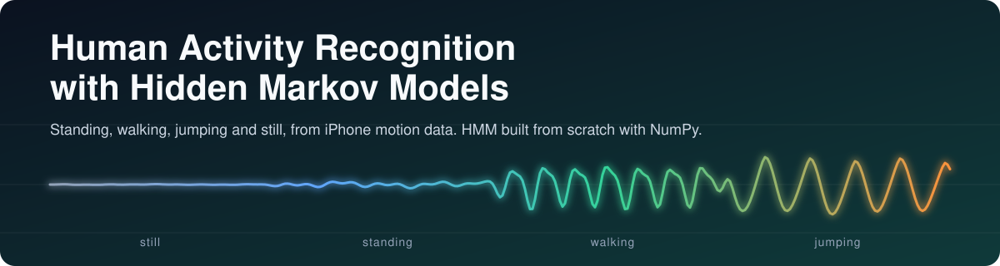
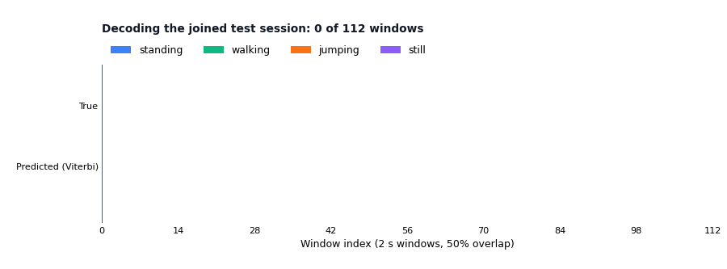
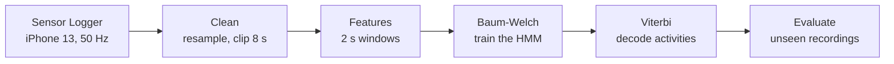
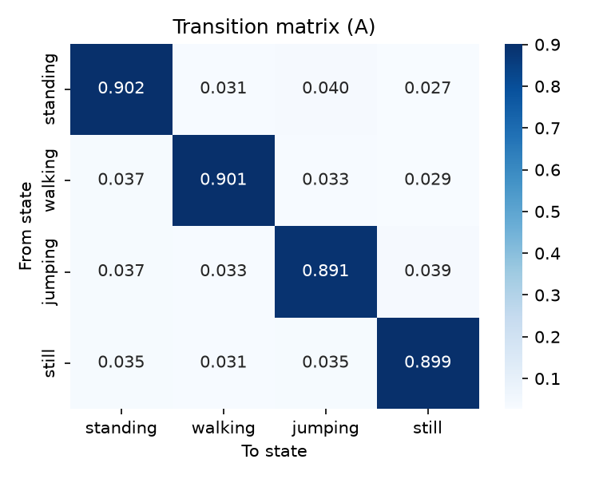
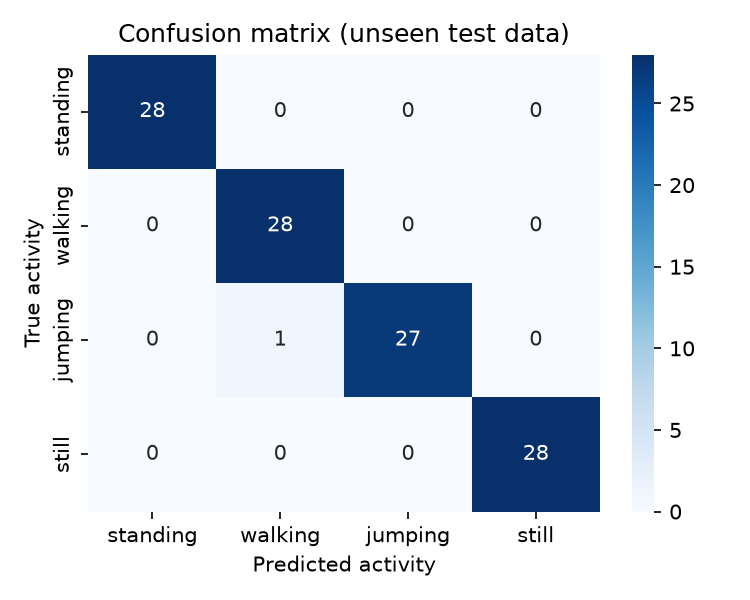
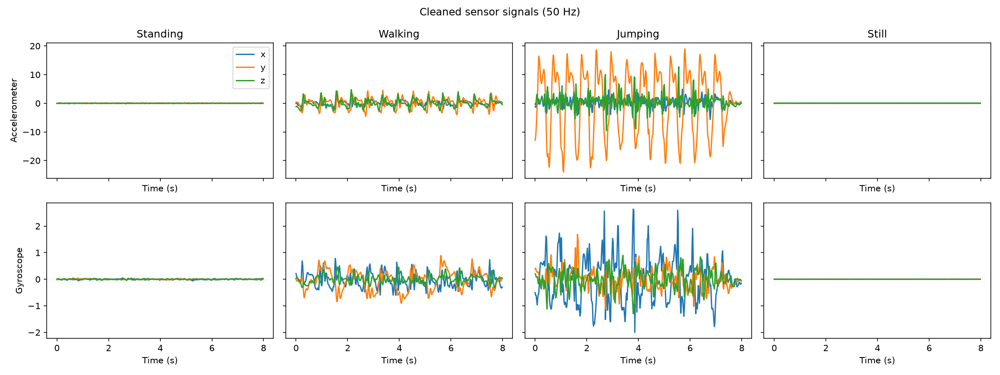
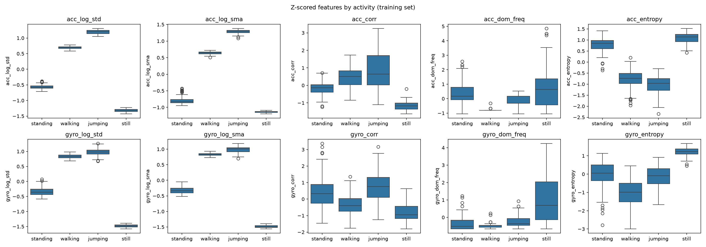
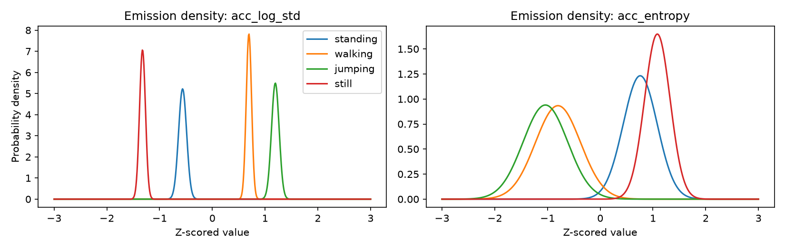
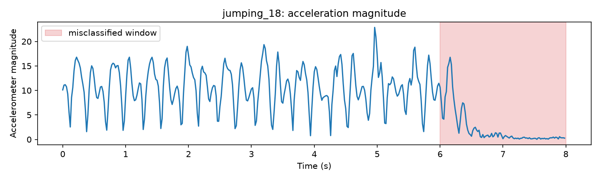

<p align="center">
  
</p>

<p align="center">
  
  
  
  
</p>

<p align="center">
  A Hidden Markov Model written from scratch that recognizes <b>standing, walking, jumping and still</b><br>
  from smartphone motion data. Use case: fitness and exercise tracking.
</p>

<table align="center">
  <tr>
    <td align="center"><b>72</b><br><sub>recordings</sub></td>
    <td align="center"><b>10</b><br><sub>features per window</sub></td>
    <td align="center"><b>3</b><br><sub>iterations to converge</sub></td>
    <td align="center"><b>99.1%</b><br><sub>accuracy on unseen data</sub></td>
  </tr>
</table>

## Demo

<p align="center">
  
</p>

<p align="center"><sub>The model decodes a joined test session window by window. The red box marks its only mistake.</sub></p>

## How it works



- **Hidden states:** the four activities.
- **Observations:** 10 features per 2 s window, from the accelerometer and gyroscope.
- **Training:** Baum-Welch learns the transition, emission and initial probabilities.
- **Decoding:** Viterbi finds the most likely activity sequence.

Everything is implemented with NumPy, with no HMM library.

## Results

Tested on 16 recordings from a separate session, never used for training or tuning.

| Activity | Windows | Sensitivity | Specificity | Accuracy |
|---|:-:|:-:|:-:|:-:|
| Standing | 28 | 1.000 | 1.000 | 1.000 |
| Walking | 28 | 1.000 | 0.988 | 0.991 |
| Jumping | 28 | 0.964 | 1.000 | 0.991 |
| Still | 28 | 1.000 | 1.000 | 1.000 |
| **Overall** | **112** | **0.991** | **0.997** | **0.991** |

<p align="center">
  
  &nbsp;&nbsp;
  
</p>

<p align="center"><sub>Learned transition matrix (left) and confusion matrix on unseen data (right)</sub></p>

111 of 112 windows are correct. Cross-validation on the training set gave 0.997, so the model holds up on a new session.

## The data

Recorded with Sensor Logger on an iPhone 13: accelerometer and gyroscope (x, y, z) at 50 Hz.

| Split | Recordings | Per activity | Length |
|---|:-:|:-:|:-:|
| Training | 56 | 14 | 8 s |
| Test (unseen) | 16 | 4 | 8 s |

<p align="center">
  
</p>

**Demonstration videos**

| Standing | Walking | Jumping | Still |
|:-:|:-:|:-:|:-:|
| [add link]() | [add link]() | [add link]() | [add link]() |

## Repository structure

```
.
├── assets/                          banner and animation used in this README
├── raw_data/                        original Sensor Logger exports (train_set, test_set)
├── clean_data/                      cleaned recordings, 50 Hz, 8 s each (train, test)
├── features/                        z-scored feature tables
├── figures/                         plots from the notebook
├── hmm_activity_recognition.ipynb   full pipeline: cleaning to evaluation
├── results_table.csv                sensitivity, specificity and accuracy
├── report.pdf                       short report
├── requirements.txt
└── README.md
```

## Run it yourself

```bash
git clone https://github.com/<your-username>/<your-repo>.git
cd <your-repo>
pip install -r requirements.txt
jupyter notebook hmm_activity_recognition.ipynb
```

Run all cells. The notebook rebuilds `clean_data/`, `features/` and `figures/` from `raw_data/` in about a minute.
Requirements: `numpy`, `pandas`, `matplotlib`, `seaborn`, `jupyter`.

## More details

<details>
<summary><b>Features</b></summary>

<br>

Five features per sensor, 10 in total, normalized with a Z-score computed on the training set only.

| Feature | Domain | What it captures |
|---|---|---|
| `log_std` | Time | Movement strength |
| `log_sma` | Time | Overall movement level across the three axes |
| `corr` | Time | How the three axes move together |
| `dom_freq` | Frequency (FFT) | Rhythm of steps and jumps |
| `entropy` | Frequency (FFT) | Periodic movement versus noise |

<p align="center">
  
</p>

</details>

<details>
<summary><b>Model and training</b></summary>

<br>

- **Emissions:** one diagonal Gaussian per activity.
- **Initialization:** emissions start from the labelled windows, so each state stays tied to one activity.
- **Transitions:** every recording holds one activity, so recordings were chained in random order into longer training sessions. Baum-Welch then learns the transition matrix from these sessions.
- **Stopping rule:** training stops when the log-likelihood changes by less than 0.001.
- **Checked:** the forward algorithm and Viterbi match a brute-force computation on a short sequence.

<p align="center">
  
</p>

</details>

<details>
<summary><b>Hyperparameter tuning</b></summary>

<br>

7-fold cross-validation, split by recording so overlapping windows never leak between folds.

| Setting | Tested | Chosen |
|---|---|---|
| Window size | 1 s, 2 s, 3 s | 2 s |
| Feature set | all, without `dom_freq`, without `corr`, accelerometer only, gyroscope only | all 10 |
| Variance floor | 0.0001, 0.001, 0.01, 0.1 | 0.001 |
| Transition smoothing | 0.1, 1, 5 | 1 |

</details>

<details>
<summary><b>The one mistake</b></summary>

<br>

The only error is the last window of `jumping_18`, predicted as walking. The plot shows that the jumping stops at about 6.3 s, so most of that window is quiet. It is a boundary window, and it is kept in the results.

<p align="center">
  
</p>

</details>

## Limitations and next steps

- All data comes from one person and one phone, and the test set has 112 windows.
- Training sessions were chained in random order, so the learned switching probabilities are almost equal. They show persistence, not real behavior.
- Next: more people and phones, longer natural sessions with real switches, and full-covariance or mixture emissions.

---

<sub>Individual assignment: Formative 2, Hidden Markov Models. Author: [add your name]</sub>